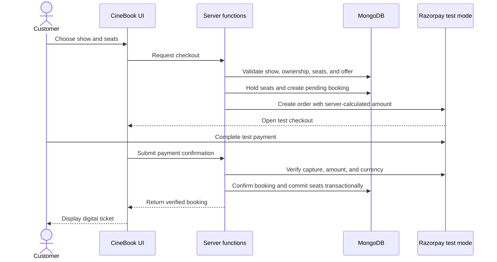
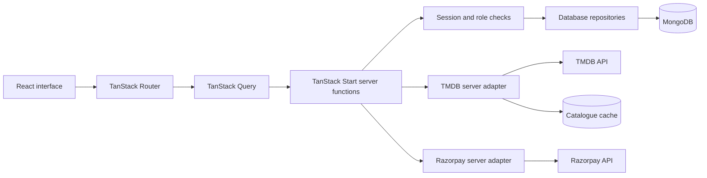

<div align="center">
  
  <h1>CineBook</h1>
  <p><strong>Your movie. Your seat. Your experience.</strong></p>
  <p>A full-stack cinema booking demo with movie discovery, interactive seat selection,<br />server-verified checkout, digital tickets, and an administrator dashboard.</p>
  <p>
    
    
    
    
    
  </p>
  <p>
    <a href="#quick-start">Quick start</a> ·
    <a href="#features">Features</a> ·
    <a href="#architecture">Architecture</a> ·
    <a href="#testing-and-quality-checks">Testing</a> ·
    <a href="#deployment">Deployment</a>
  </p>
</div>

---

## Overview

CineBook brings the cinema booking journey into one responsive application: discover a movie, choose a theatre and showtime, select seats, review an offer, complete test checkout, and return to your booking history or ticket.

Movie metadata comes from **TMDB**. **MongoDB** stores accounts, sessions, theatre inventory, seat holds, bookings, payments, and favorites. **TanStack Start** connects the React interface to server-side operations, while **Razorpay** provides the test checkout integration.

> [!IMPORTANT]
> CineBook is a demonstration project. Showtimes are generated from trusted movie and theatre records; they are not connected to live exhibitor inventory. Checkout is intended for Razorpay test mode, and ticket QR codes are not valid for cinema admission. See [current scope and next steps](#current-scope-and-next-steps) before considering a real-money launch.

## Contents

- [Features](#features)
- [Technology](#technology)
- [Quick start](#quick-start)
- [Environment configuration](#environment-configuration)
- [Administrator setup](#administrator-setup)
- [Booking and payment flow](#booking-and-payment-flow)
- [Architecture](#architecture)
- [Project structure](#project-structure)
- [Application routes](#application-routes)
- [Security and data integrity](#security-and-data-integrity)
- [Testing and quality checks](#testing-and-quality-checks)
- [Development commands](#development-commands)
- [Deployment](#deployment)
- [Troubleshooting](#troubleshooting)
- [Current scope and next steps](#current-scope-and-next-steps)
- [Contributing](#contributing)
- [Further documentation](#further-documentation)
- [Acknowledgments and license](#acknowledgments-and-license)

## Features

### Discover your next movie

- Browse now-playing, popular, top-rated, and upcoming titles.
- Search movies and filter the catalogue by language, genre, format, and rating.
- Explore movie details, artwork, and trailers.
- Choose a city and browse theatres and available demonstration showtimes.
- Save favorites to your account.
- Continue browsing previously cached movie lists during temporary TMDB outages, with a visible data-status notice.

### Book and manage seats

- Select seats from the show's configured layout, with recorded sold seats and active holds reflected in availability.
- Review ticket prices, convenience fees, taxes, and eligible offer discounts.
- Complete Razorpay test checkout with server-side order and payment verification.
- View booking history and digital tickets with QR codes and printable presentation.
- Cancel eligible bookings before the show starts; paid cancellations are recorded as refund pending.

### Keep an account

- Register and sign in with database-backed accounts.
- Update your name and phone number.
- Revisit saved movies, booking activity, and in-app notifications.
- Sign out with server-side session revocation.

### Understand the business demo

The administrator dashboard includes paid revenue, registered users, distinct linked customers, booked seats, booking/payment states, a 14-day revenue chart, top movies and customers, and the latest 20 booking requests. Totals cover the full matching dataset rather than only the recent records shown on screen.

The interface includes responsive navigation, loading states, error feedback, and a dedicated mobile navigation bar.

## Technology

- **Application:** React 19, TypeScript, TanStack Start, and TanStack Router.
- **Server data:** TanStack Query and typed server functions.
- **UI:** Tailwind CSS 4, Radix UI primitives, Lucide icons, Recharts, and Sonner.
- **Forms and validation:** React Hook Form and Zod.
- **Backend:** Node.js 24, Nitro's Node server output, and the official MongoDB driver.
- **Integrations:** TMDB movie metadata, Razorpay test payments, and QR code generation.
- **Tooling:** Vite, ESLint, Prettier, Node's test runner, and Playwright.

Exact dependency ranges and scripts live in [`package.json`](package.json). Use the committed npm lockfile for reproducible installs.

## Quick start

### 1. Prepare your environment

Install **Node.js 24** and npm, then clone this repository using its GitHub **Code** menu and open a terminal in the project folder.

For the complete application, you will also need:

- A transaction-capable MongoDB replica set or Atlas cluster, with a database user and network access configured for your machine.
- A TMDB API read access token or API key.
- Razorpay **test-mode** credentials for checkout.
- Microsoft Edge if you plan to run the browser tests with the current Playwright configuration.

### 2. Install dependencies

```sh
npm ci
```

### 3. Create the local configuration

Copy [`.env.example`](.env.example) to `.env` if `.env` does not already exist.

**PowerShell:**

```powershell
if (-not (Test-Path .env)) { Copy-Item .env.example .env }
```

**macOS / Linux:**

```sh
[ -f .env ] || cp .env.example .env
```

Fill in the variables described below. Generate a session secret locally with:

```sh
node -e "console.log(require('node:crypto').randomBytes(32).toString('hex'))"
```

Paste the generated value into `SESSION_SECRET` in your local `.env`. Keep that value private.

### 4. Start the application

```sh
npm run dev
```

Open the local URL printed by Vite. Restart the server after changing environment variables.

### 5. Explore the configured experience

Register through `/login`, browse the catalogue, and select a movie. To initialize reference data in a fresh development database, follow [administrator setup](#administrator-setup) and inspect the seed behavior first.

**Just exploring the interface?** When TMDB is unavailable and no usable cache exists, the app displays a labeled sample catalogue. This does not replace the MongoDB-backed account, reservation, or payment services; those features still require their configuration.

## Environment configuration

Use [`.env.example`](.env.example) as the configuration template. All credentials belong on the server; do not rename them with a `VITE_` prefix.

### Accounts and database

- **`MONGODB_URI`** — MongoDB connection string for the application database user. URL-encode reserved characters in credentials. Booking transactions require a replica set or Atlas cluster.
- **`MONGODB_DB`** — Application database name; the template uses `cinebook`.
- **`SESSION_SECRET`** — At least 32 unpredictable characters for encrypted sign-in cookies. Keep it stable across application instances. Rotation invalidates existing cookies.

### Movie catalogue

- **`TMDB_ACCESS_TOKEN`** — TMDB API read access token, or use `TMDB_API_KEY`.
- **`TMDB_API_KEY`** — Alternative TMDB API credential.
- **`TMDB_IMAGE_BASE_URL`** — Image base URL; the template uses `https://image.tmdb.org/t/p`.
- **`TMDB_CACHE_FILE`** — Catalogue cache location, defaulting to `.cache/tmdb-catalogue.json`. Set an empty value to disable disk caching. Use a writable persistent location if the cache should survive deployments.

### Checkout

- **`RAZORPAY_KEY_ID`** — Razorpay test key ID, beginning with `rzp_test_`. This identifier is intentionally passed to the checkout client.
- **`RAZORPAY_KEY_SECRET`** — Corresponding private key secret. It remains on the server.

### Administration and runtime

- **`CINEBOOK_ADMIN_EMAIL`** — Designated administrator email. Setting this value does not grant an account the administrator role.
- **`CINEBOOK_SEED_TOKEN`** — Required for the dashboard seed action, alongside a verified administrator session. The submitted token must match this server value; a missing or incorrect token blocks seeding.
- **`NITRO_PRESET`** — Optional build-target override. The supported default is `node-server`.

The browser integration suite has separate `MONGODB_TEST_URI` and `MONGODB_TEST_DB` settings; see [testing](#testing-and-quality-checks). It does not automatically use the application database.

Local `.env` files, `*.local` backups, dependencies, build outputs, and cache directories are excluded by [`.gitignore`](.gitignore). Supply deployment credentials through your host's environment or secret manager.

## Administrator setup

There is no shared administrator password or automatic promotion during registration.

1. Set `CINEBOOK_ADMIN_EMAIL` on the server.
2. Register that account through `/login`.
3. Verify that the account belongs to the intended administrator.
4. Check the designated account without changing its role:

   ```sh
   node promote-admins.cjs
   ```

5. After reviewing the account, apply the role update:

   ```sh
   node promote-admins.cjs --apply
   ```

6. Sign out and sign back in. Verified administrators are directed to `/admin`.

When a designated email is configured, authorization requires both the stored administrator role and the matching email. Administrative server operations independently verify access.

### Development reference data

Inspect [`src/lib/db/seed.server.ts`](src/lib/db/seed.server.ts) before using the dashboard's seed action. It creates indexes and reference data; offers can be upserted without `force`, and forced seeding can overwrite theatre reference fields. Use a separate development database and review existing data before seeding.

For account migration, index conflicts, legacy bookings, and existing administrator roles, see [DEPLOYMENT.md](DEPLOYMENT.md).

## Booking and payment flow



The server also verifies the payment signature and its binding to the stored order. An idempotency key and an order-creation lease help prevent duplicate checkout work.

Seat selections must match the stored layout and contain between 1 and 10 unique seats. Price calculation is authoritative on the server. The current demo pricing adds a ₹25 convenience fee per seat and rounded taxes of 6% on tickets plus fees, then subtracts the validated discount. These are application demo rules, not a statement of statutory tax requirements.

A late captured payment cannot take seats whose hold has expired and been reassigned. Paid cancellations and captured payments that cannot receive seats become `REFUND_PENDING`. That state records work still needed; it does not mean a gateway refund has completed.

## Architecture



**The browser handles presentation and interaction.** Protected server functions resolve the signed-in user, validate requests, and call the repositories or external adapters. The database owns the persisted show configuration, bookings, payment references, and seat state.

**Movie metadata and booking inventory have different sources.** TMDB supplies film information; MongoDB stores the application's demonstration theatres, screens, shows, and reservations.

**Catalogue recovery is explicit.** The TMDB adapter retries transient failures, shares concurrent requests, and loads trailers separately. Successful lists are cached for up to seven days. Cached data or sample data is accompanied by a visible notice rather than being presented as a successful live refresh.

### Data model

The main MongoDB collections are:

- `users` and `sessions` for accounts and revocable sign-in sessions.
- `theatres`, `screens`, and `shows` for demonstration inventory.
- `show_seats` for sold seats and active holds.
- `bookings` and `payments` for reservations and payment records.
- `favorites`, `offers`, and `meta` for saved movies, offers, and supporting metadata.

Unique indexes protect identifiers, account email addresses, checkout idempotency, favorites, and payment references. Index creation errors stop affected operations rather than silently weakening those constraints.

## Project structure

```text
CineBook/
├── public/                  # Favicon, static images, and robots.txt
├── src/
│   ├── components/          # Shared interface and booking components
│   │   ├── admin/           # Administrator dashboard
│   │   └── ui/              # Reusable UI primitives
│   ├── data/                # Demonstration catalogue/reference data
│   ├── hooks/               # Shared React hooks
│   ├── lib/
│   │   ├── db/              # MongoDB models, repositories, seed, analytics
│   │   ├── auth.server.ts   # Sessions and authorization
│   │   ├── cinebook.functions.ts
│   │   ├── tmdb.server.ts   # Movie API integration
│   │   └── razorpay.server.ts
│   ├── routes/              # File-based pages and root shell
│   ├── router.tsx           # Router configuration
│   ├── routeTree.gen.ts     # Generated route tree
│   ├── server.ts            # SSR server entry and error wrapper
│   ├── start.ts             # Application middleware
│   └── styles.css           # Global styles and design tokens
├── tests/                   # Isolated regression tests and browser tests
├── scripts/                 # Build utilities
├── audit/                   # Recorded checks and implementation reports
├── .env.example             # Configuration template without credentials
├── DEPLOYMENT.md            # Runtime, migration, and administrator guide
├── promote-admins.cjs       # Explicit administrator promotion utility
├── playwright.config.cjs    # Browser test configuration
└── vite.config.ts           # Build and Node runtime configuration
```

## Application routes

- **`/`** — Home and movie discovery.
- **`/movies`** — Searchable, filterable movie catalogue.
- **`/upcoming`** — Upcoming releases.
- **`/movie/$movieId`** — Movie details and show selection.
- **`/theatres`** — Theatre browsing.
- **`/book/$showId`** — Seat selection.
- **`/checkout/$showId`** — Checkout.
- **`/ticket/$bookingId`** — Booking ticket.
- **`/bookings`** — Your booking history.
- **`/favorites`** — Saved movies.
- **`/offers`** — Available offers.
- **`/login`** — Registration and sign-in.
- **`/profile`** — Account details and activity.
- **`/admin`** — Administrator dashboard.

The `$...` segments are TanStack Router parameters. Private data and mutations require server-side authorization even when a page shell is publicly reachable.

## Security and data integrity

The implementation includes:

- Encrypted **HttpOnly, SameSite** cookies, with the Secure flag in production.
- Random session tokens stored as SHA-256 digests in MongoDB, with expiry checks and revocation on logout.
- Current database user and role checks for protected operations.
- PBKDF2-HMAC-SHA256 password hashing with 600,000 iterations for new accounts; compatibility handling for older hashes is documented separately.
- Ownership checks for bookings and favorites, and server-calculated checkout amounts.
- HMAC payment signature checks plus provider capture, amount, currency, and stored-order verification.
- Transactional booking/payment transitions and uniqueness constraints.
- Private responses marked `private, no-store`.
- Per-process authentication rate limiting.

These controls are implemented behavior, not a claim of independent security certification. Multi-instance deployments still need shared rate limiting, and service-backed payment and transaction testing remains essential.

## Testing and quality checks

Run the core checks from the repository root:

```sh
npm test
npx tsc --noEmit
npm run lint
npm run build
```

The local check on **28 October 2026** passed all **61 unit tests**, TypeScript checking, and the production build. Lint completed with **0 errors and 9 React Fast Refresh warnings**. This is a dated local result, not a live CI status badge.

### Isolated regression tests

`npm test` exercises real application handlers and repository code with explicitly mocked transport, database, or provider boundaries. Coverage includes account validation, sessions, ownership, booking rules, pricing, payment signatures, idempotency, cancellation, administrator analytics, and TMDB failure recovery.

The unit harness does not load `.env`, disables network requests by default, and does not connect to a live MongoDB database or initiate payments.

### Browser tests

```sh
npm run test:e2e
```

The current Playwright configuration uses **Microsoft Edge** and an isolated development server at `http://127.0.0.1:4180`. Leave that port available. Public browser cases deliberately disable live database, TMDB, and payment credentials to test the labeled offline experience. Dashboard UI cases use mocked RPC responses.

Real database cases run only when both `MONGODB_TEST_URI` and `MONGODB_TEST_DB` are supplied to the test process, and the database name starts with `cinebook_audit_`. Use a disposable test database. Missing prerequisites produce skipped cases, not proof that database integration passed.

Passing isolated tests does not establish real provider capture/refund behavior, cross-process reservation races, or production MongoDB transaction behavior. See [test scope and limitations](tests/README.md) for the exact boundaries.

## Development commands

```sh
npm ci                   # Install locked dependencies
npm run dev              # Start the development server
npm run build            # Build using the configured Nitro target
npm run build:node       # Explicitly build for the Node server runtime
npm run build:dev        # Build with Vite development mode
npm run preview          # Preview the build locally
npm run start            # Run .output/server/index.mjs
npm test                 # Run isolated regression tests
npm run test:e2e         # Run Playwright browser tests
npx tsc --noEmit         # Check TypeScript without emitting files
npm run lint             # Run ESLint
npm run format           # Format the repository with Prettier
```

`npm run format` can change many files; review its diff before committing.

## Deployment

CineBook needs a **Node.js server host** and a **transaction-capable MongoDB deployment**. Static-only hosting does not run the account, booking, and payment backend.

1. Configure Node.js 24 on the host.
2. Provide server environment variables through the host's secret manager.
3. Install and build:

   ```sh
   npm ci
   npm run build:node
   ```

4. Start the generated server:

   ```sh
   npm run start
   ```

5. Serve the application over HTTPS and verify database connectivity, index creation, sign-in, and authorized access.
6. Exercise the complete booking flow with test credentials before enabling any wider access.

The server entry point is `.output/server/index.mjs`. Keep `SESSION_SECRET` consistent across instances and ensure the host can reach MongoDB, TMDB, and Razorpay. Use a persistent writable cache path only if you want catalogue snapshots to survive restarts.

The default Nitro target is `node-server`. Changing `NITRO_PRESET` does not establish compatibility with the official MongoDB driver. Follow [DEPLOYMENT.md](DEPLOYMENT.md) for runtime requirements, existing-data migration, and payment prerequisites.

## Troubleshooting

<details>
<summary><strong>The movie catalogue shows sample or cached data</strong></summary>

Check the server's TMDB credentials and connectivity to `api.themoviedb.org`. Being able to open the TMDB website does not establish API reachability. A cached catalogue can remain available for up to seven days; a fresh installation without usable data shows a labeled sample catalogue. Restart the development server after updating `.env`.

</details>

<details>
<summary><strong>MongoDB authentication fails</strong></summary>

Use the database user's credentials, not the Atlas website account password. Verify the cluster, authentication source, network access, and URL encoding of reserved characters in the URI. Do not include the connection string in an issue or screenshot. Confirm that the cluster supports transactions before testing checkout.

</details>

<details>
<summary><strong>Sign-in sessions are not configured, or old cookies stop working</strong></summary>

Set a stable `SESSION_SECRET` with at least 32 unpredictable characters, verify MongoDB connectivity, and restart the server. Secret rotation and the migration from legacy cookies require a new sign-in. Production cookies require HTTPS.

</details>

<details>
<summary><strong>The designated administrator cannot open the dashboard</strong></summary>

An email setting alone does not grant privileges. Register the intended account, review it with `node promote-admins.cjs`, deliberately apply the role update, and sign in again. If `CINEBOOK_ADMIN_EMAIL` is set, it must match the account with the stored administrator role.

</details>

<details>
<summary><strong>Checkout fails or seats become unavailable</strong></summary>

Confirm that Razorpay test credentials are configured and that MongoDB supports multi-document transactions. Seats can become unavailable when another booking holds them or an existing hold expires. Refresh availability and create a new checkout attempt; do not manually mark a payment as paid to bypass verification.

</details>

<details>
<summary><strong>A cancelled booking says refund pending</strong></summary>

This is intentional. The current application records the need for a refund but does not execute or reconcile gateway refunds. `REFUND_PENDING` must not be interpreted as money already returned.

</details>

<details>
<summary><strong>Browser tests cannot start or database tests are skipped</strong></summary>

The checked-in configuration expects Microsoft Edge and an available port 4180. Database tests also require explicit isolated test credentials and a database name beginning with `cinebook_audit_`. Read the reported skip reason and [tests/README.md](tests/README.md) before changing configuration.

</details>

## Current scope and next steps

The following work remains before treating CineBook as a real cinema ticketing service:

- [ ] Connect verified exhibitor inventory and real show schedules.
- [ ] Implement payment webhooks and reconciliation for interrupted or delayed callbacks.
- [ ] Implement and verify gateway refund execution and reconciliation.
- [ ] Complete service-backed checkout, capture, refund, and concurrent-seat integration tests.
- [ ] Add a real ticket validation/admission workflow.
- [ ] Add account email verification; verify ownership manually before administrator promotion today.
- [ ] Add shared rate limiting for multi-instance deployments.
- [ ] Review legacy booking ownership, historic payment labels, and index conflicts before migrating existing data.

These items describe known gaps, not features already delivered. Historical audit reports record the environment and results at the time they were written; rerun relevant checks against the environment you intend to deploy.

## Contributing

1. Create a branch for a focused change.
2. Keep credentials in local or hosted environment configuration.
3. Make the change and add meaningful regression coverage where behavior changes.
4. Run the relevant tests, TypeScript check, lint, and production build.
5. Update configuration or deployment documentation when behavior changes.
6. Open a pull request explaining the problem, resulting behavior, and validation performed.

When reporting a problem, include reproduction steps, expected behavior, actual behavior, and sanitized logs. Exclude credentials, cookies, personal booking data, and payment secrets.

## Further documentation

- [Deployment and administrator guide](DEPLOYMENT.md) — hosting, sessions, indexes, migrations, seeding, and payment constraints.
- [Test guide](tests/README.md) — isolation guarantees, browser configuration, and integration-test limits.
- [Audit report](audit/REPORT.md) — recorded findings and outstanding prerequisites.
- [Test results](audit/TEST-RESULTS.md) — recorded validation evidence.
- [Administrator dashboard notes](audit/ADMIN-DASHBOARD.md) — analytics behavior and validation.
- [Initial workflow inventory](audit/INITIAL-INVENTORY.md) — historical project assessment.
- [Environment template](.env.example) — supported local configuration.

## Acknowledgments and license

CineBook uses TMDB for movie metadata and artwork, Razorpay for test checkout, and the open-source libraries listed in `package.json`. Provider integrations do not imply endorsement or affiliation.

No project license file is currently included. Public repository access does not itself grant a license to reuse or redistribute the project; obtain the owner's permission and review third-party asset and dependency terms before doing so.
